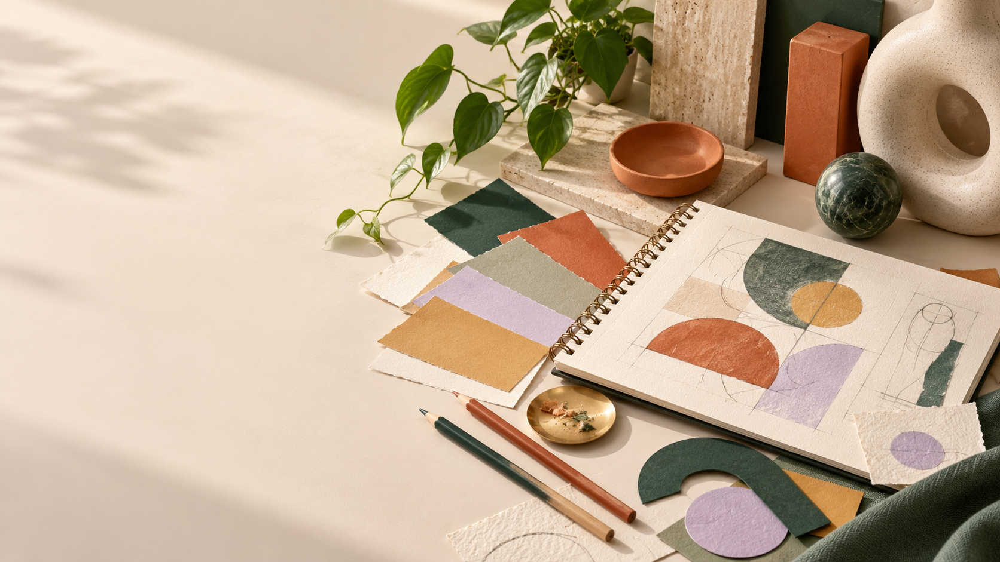
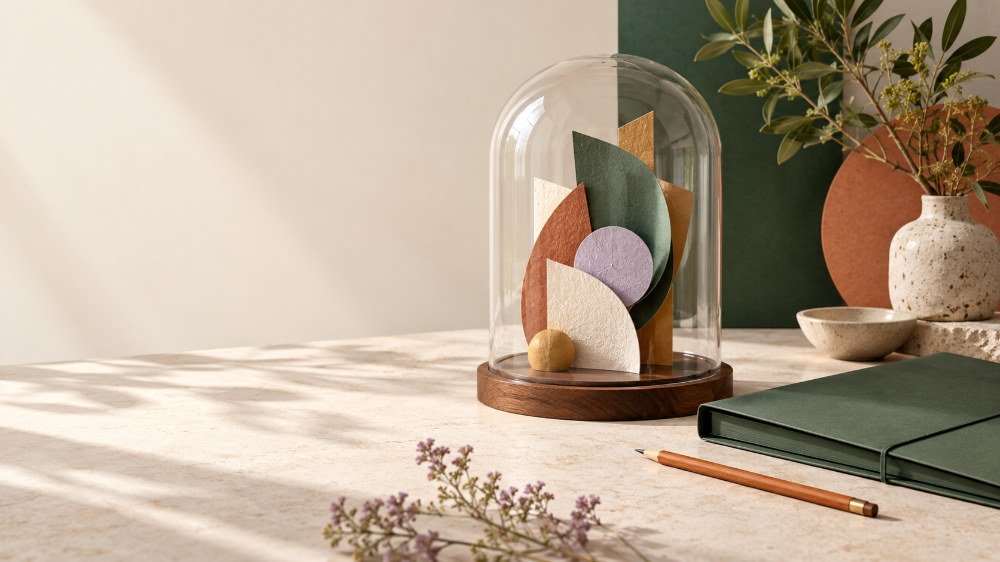
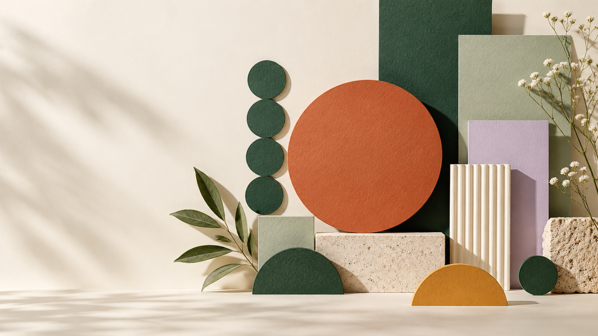
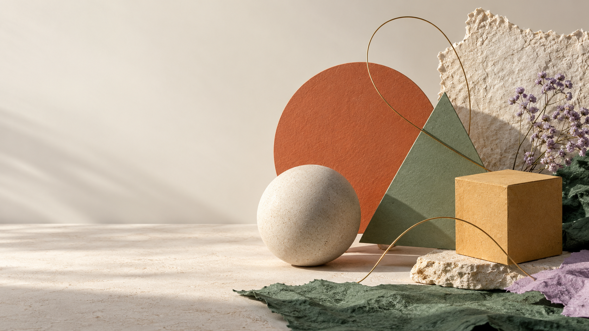
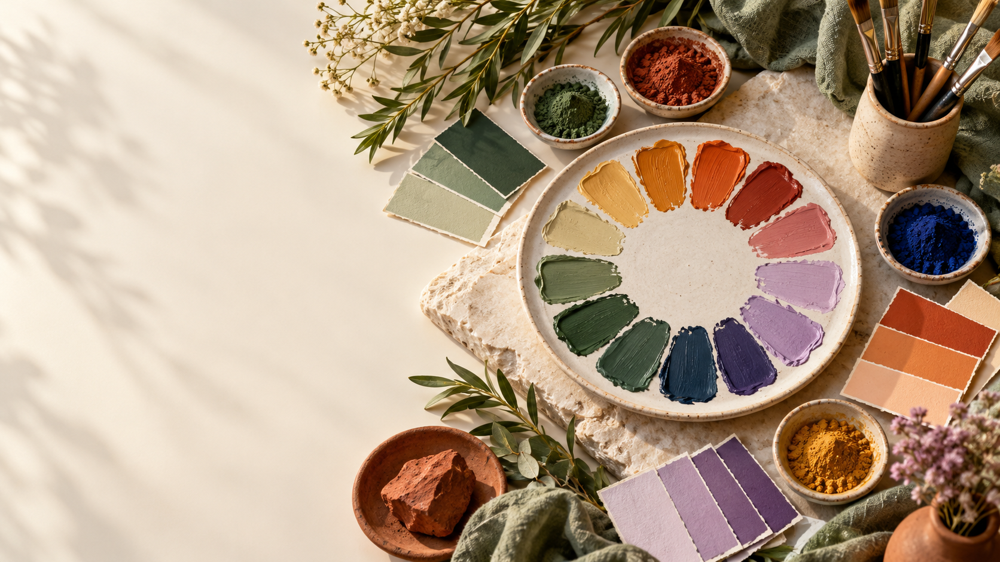
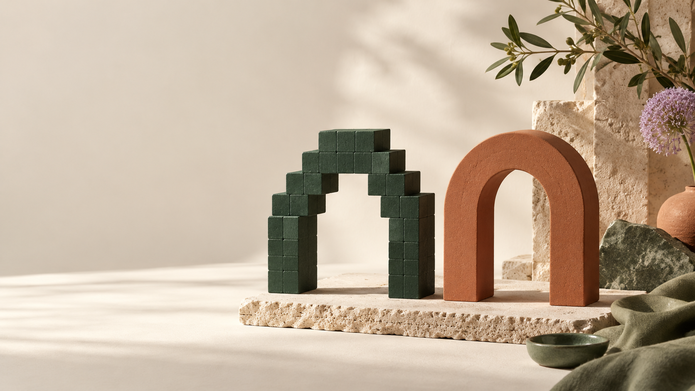
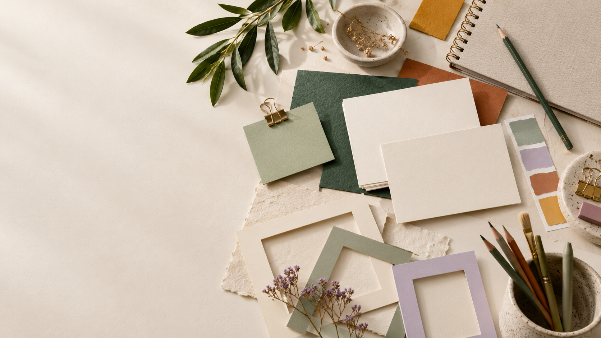
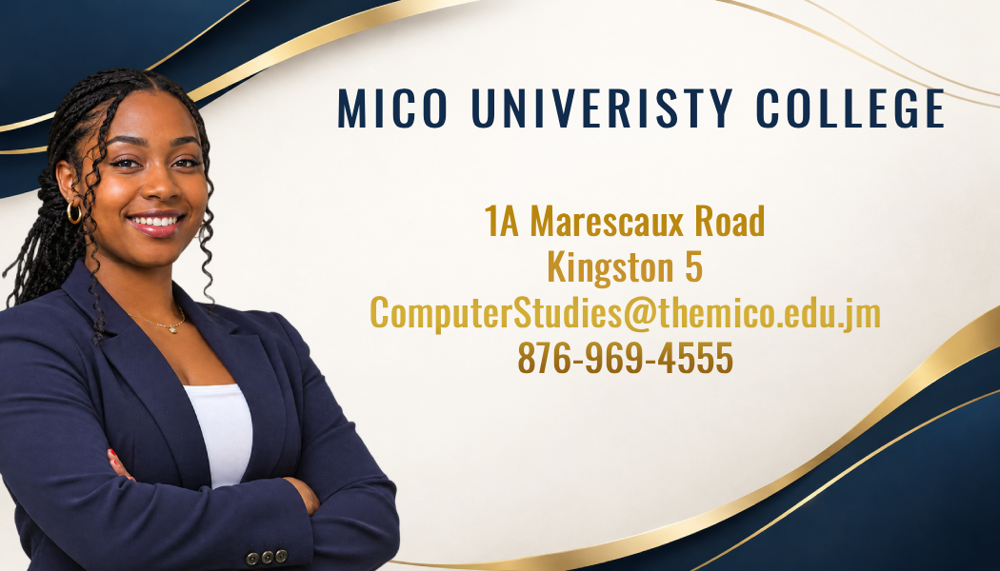
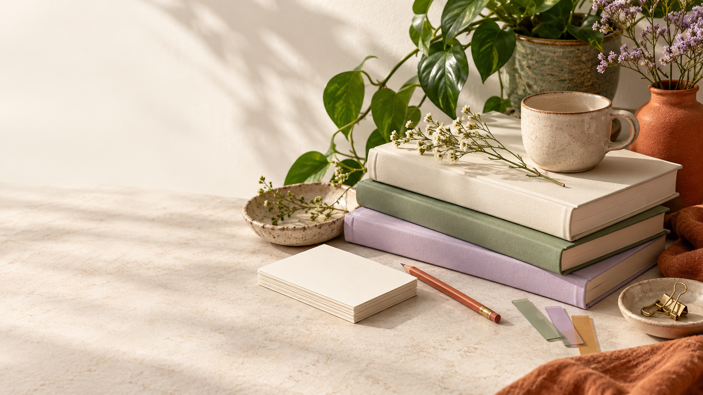

# My portfolio page content

MELICIA PARKER / GRAPHICS DESIGN PORTFOLIO

# The Visual Canvas.

Welcome to my graphics design portfolio. I am Melicia Parker, and The Visual Canvas brings together my exploration of colour, form, typography and visual storytelling.

Explore my portfolio →View my coursework →

 Introduction to Graphics Design · Mico University College

STUDIES IN VISUAL THINKINGVOL. 01

Visual example: An original abstract poster combining an M letterform, geometric shapes and a colour palette

FORM. COLOUR. POSSIBILITY.+MADE TO COMMUNICATE

THE PURPOSE

## Welcome to my portfolio.

### What is graphic design?

Graphic design is the purposeful arrangement of typography, images, colour and layout to communicate with an audience. It appears in posters, logos, publications, packaging, presentations and websites. In my work, I consider the message, its audience and how clearly the finished design communicates.

### My portfolio rationale

I created my portfolio to connect the theory I study in Introduction to Graphics Design with practical application. It explains the ideas behind my design choices, presents my coursework, and gives me a space to reflect on clear communication, responsible use of creative material and visual consistency.

THE NOTEBOOK

## There’s a reason behind the design.

Explore the ideas that shape my work.

01↗

### Creative rights

Copyright in Jamaica

02↗

### Good design has a rhythm

Principles of design

03↗

### Start with the essentials

Elements of design

04↗

### Find your colour story

Colour theory

05↗

### Choose your medium

Raster & vector

06↗

### A little about the author

Meet Melicia

## What my portfolio demonstrates

A successful design does more than decorate a page: it makes a message easier to notice, understand and act on. My portfolio connects design vocabulary with visual evidence, responsible sourcing and practical production choices. The theory pages include annotated demonstrations, comparisons and examples of how to apply each concept.

 | Learning area | Evidence in this portfolio
 | Responsible practice | Copyright in Jamaica, licensing decisions, attribution and ethical use of assets.
 | Composition | Illustrated principles with applications to posters, logos and page layouts.
 | Visual vocabulary | Explanations and examples of line, shape, texture, space, form and value.
 | Colour decisions | Colour models, palette relationships, contrast and accessible communication.
 | Digital production | Raster/vector comparison, resolution, compression and export decisions.
 | Practical application | A dedicated Artefacts page presenting six project categories and their design focus.

## My design process: from brief to finished work

- Understand the brief. Identify the audience, purpose, message and required output. A poster announcing an event has different priorities from a small logo.
- Research responsibly. Collect references and record the creator, licence and source of any assets. Inspiration should guide a new solution rather than become an uncredited copy.
- Explore ideas. Sketch more than one composition. Consider focal points, alignment, colour and the relationship between text and image.
- Develop the artwork. Choose tools and formats suited to the work. Use layers, sensible file names and editable source files.
- Evaluate and revise. Check accuracy, legibility, visual hierarchy and accessibility. Test the design at its intended size.
- Export and reflect. Keep the editable master, export a suitable presentation file and explain what worked and what could improve.

THE LEARNING JOURNEY

One idea leads to the next.

Next pageCopyright in Jamaica →

Create with confidence and respect for creative rights.

---

01 / RESPONSIBLE PRACTICE

# Copyright in Jamaica.

In my portfolio, understanding copyright helps me respect other creators and make responsible choices about images, fonts and design assets.

## What is copyright?

Copyright protects original expression in qualifying works, including drawings, illustrations, photographs and other artistic works. It protects the expression of an idea rather than the general idea itself.

## The Jamaican context

Jamaica's Copyright Act, 1993, as amended, provides the central legal framework. Copyright can give rights holders control over activities such as copying, adapting and distributing protected work. Moral rights can also concern attribution and treatment of a work, subject to the law's conditions.

Protection is generally automatic for qualifying works: a work does not become free to use simply because it appears online or lacks a copyright symbol. Ownership, duration and permitted exceptions depend on the circumstances and applicable law.

## Why copyright matters to my design work

Designers should protect their own work and respect the rights attached to photographs, illustrations, fonts and other assets. Check ownership and licence terms before use. Giving credit alone does not replace permission where permission is required.

## Applying it in practice

- Photograph in a poster: use your own image or obtain a suitable licence; do not assume a search result is free to reuse.
- Client logo: use a written agreement to clarify permitted uses and ownership of the final work.
- Licensed illustration: follow any attribution, modification and commercial-use conditions.
- Student portfolio: identify your own work and acknowledge permitted third-party material.

## What can be protected?

For graphics design, relevant works may include original illustrations, photographs, layouts with protectable expression and other qualifying artistic creations. Copyright does not give a designer ownership of every general idea, style, technique or colour. A general idea for a fruit logo is different from the particular drawing used to express it.

A logo can raise more than one intellectual-property issue: copyright may protect original artwork, while trademark law concerns signs identifying the source of goods or services. Registering a business name is not the same as obtaining permission to copy someone else's design.

## Economic rights, moral rights and ownership

 | Area | Meaning for a designer
 | Economic rights | Permission may be needed to reproduce, adapt, publish or distribute protected work. The exact rights depend on the category of work and applicable law.
 | Moral rights | Attribution and objection to certain treatment of a work can matter separately from permission to reproduce it. Conditions and exceptions must be checked.
 | Ownership | Do not assume the person who pays for a design automatically owns every right. Employment, commissioning arrangements and written agreements can affect ownership.
 | Licensing | A licence can grant limited permission without transferring ownership. Check purpose, medium, duration, territory, modification and redistribution conditions.
 | Assignment | A transfer of rights differs from a licence. Specify what is transferred and follow the legal requirements for a valid agreement.

## Exceptions are limited, not automatic permission

Jamaican copyright law includes exceptions and limitations, including forms of fair dealing for purposes such as research or private study, criticism or review, and reporting current events, subject to the relevant conditions. A use being educational, non-commercial or credited does not automatically make every copying activity lawful.

The duration of protection depends on the category of work, authorship and applicable amendments. Jamaica's Copyright Act, 1993, and subsequent amendments, including the Copyright (Amendment) Act, 2015, provide the legislative context.

## A practical permission checklist

- Identify the creator and rights holder.
- Locate the actual licence or obtain permission; a search-engine result is not a licence.
- Check whether the intended use, editing, publication and distribution are permitted.
- Provide the required credit and retain evidence of permission.
- Record the source in the bibliography and distinguish third-party assets from original work.
- If the terms are unclear, choose an original or clearly licensed alternative.

## Applying licences to a design brief

 | Situation | Appropriate response
 | A photograph is publicly visible on social media. | Do not download it into a public poster merely because it is easy to access. Obtain suitable permission or use an alternative.
 | An asset is labelled CC BY. | Check the specific licence version, give the required attribution, provide the licence reference and indicate changes as required.
 | An asset is labelled CC BY-NC. | The non-commercial restriction matters. Do not assume a commercial client project is permitted.
 | An asset is labelled CC BY-ND. | The no-derivatives restriction affects sharing modified versions. Check whether the proposed alteration and distribution are allowed.
 | A client supplies an image. | Ask the client to confirm the relevant rights; receiving a file does not establish permission.
 | A designer uses a downloaded font. | Read the font licence for desktop, web embedding, redistribution and other intended uses.

## Attribution example

A useful credit records: Creator — Title — Source link — Licence — Changes made. Fill these fields with the real asset information. Attribution documents the source but does not cure a use that the licence prohibits.

Official resources for checking the law: Jamaica Intellectual Property Office (https://www.jipo.gov.jm/) and WIPO Lex: Jamaica (https://www.wipo.int/wipolex/en/legislation/members/profile/JM).

## Applying copyright to my portfolio

My Photopea composites combine visual material into a new arrangement. Rights in an individual source photograph can exist separately from rights in a finished composition. Changing an image, removing a background or adding effects does not automatically remove the original creator's rights.

For each external asset I use, I need to record the creator, source, licence or permission, and any required credit. I also need to check whether publishing the result on a public website is permitted. This approach supports my aim of presenting original work while acknowledging the material used to make it.

Previous page← HomeNext pageDesign Principles →

See how structure brings a composition together.

---

02 / PRINCIPLES OF GRAPHIC DESIGN

# The principles behind my work.

In my portfolio, design principles help me organise visual elements, establish a clear message and guide the viewer through my work.

## Balance, contrast and visual relationships

Visual example: Two equally sized circles balanced across a central axis

### Balance

Balance is the distribution of visual weight. Size, colour, value, texture and position can make an element feel heavier or lighter. Symmetrical balance mirrors weight across an axis; asymmetrical balance uses different elements to create equilibrium; radial balance organises elements around a centre.

In my portfolio: My two-column layouts balance imagery with text. In my Girl and House composition, the figure and building occupy different areas rather than forming a mirror image.

Visual example: Light large type against dark background contrasts with small dark type

### Contrast

Contrast is a noticeable difference between elements, such as light and dark, large and small, thick and thin, or smooth and textured. It separates information and creates emphasis. Contrast should support a clear reading order rather than make every item compete equally.

In my portfolio: The bright fruit in my Basket of Fruits composition stands out against its dark background. My portfolio uses dark text on cream to make explanations readable.

Visual example: Three horizontal bars share one left edge

### Alignment

Alignment places elements along a shared edge, centre or baseline. Left, right and centred alignment create different effects; a grid can coordinate multiple columns. Deliberate alignment creates relationships even when objects are far apart.

In my portfolio: My headings and paragraphs share a left edge. Aligning the image and explanation within an artefact card makes each project easier to scan.

Visual example: Four repeated terracotta circles establish a rhythm

### Repetition

Repetition reuses a visual feature, such as a colour, typeface, shape or spacing interval. It creates consistency and recognition across a composition or a series of pages. Small variations can retain interest within a repeated system.

In my portfolio: I repeat my logo, cream background, green text and heading styles throughout my portfolio so the pages feel connected.

Visual example: Two separated clusters demonstrate proximity

### Proximity

Proximity groups related elements by placing them close together. A larger gap separates unrelated groups. It helps a viewer understand relationships without extra boxes or lines; the spacing within a group should usually be smaller than the spacing between groups.

In my portfolio: I keep each artefact image near its title, software name and description, while leaving more space before the next project.

## Emphasis, organisation and visual flow

Visual example: One larger terracotta circle stands out among small green circles.

### Emphasis

Emphasis establishes a focal point: the part a viewer should notice first. Isolation, contrasting colour, size, position or detail can attract attention. A clear dominant element gives supporting information a role.

In practice: The yellow door in my House with Lines illustration contrasts with the surrounding walls and becomes a noticeable accent.

Visual example: A large title, medium heading and small text lines show three hierarchy levels.

### Hierarchy

Hierarchy gives information levels of importance. Scale, weight, colour, placement and spacing can establish a title, a supporting heading and body text. It answers what to read first, second and third.

In practice: On my pages, the large title introduces the subject, section headings organise topics and smaller paragraphs explain the detail.

Visual example: A larger foreground figure is compared with a smaller background house.

### Scale and proportion

Scale concerns size relative to another object or the viewing context. Proportion concerns the size relationships between parts. Changing either can suggest importance, distance or a deliberate exaggeration.

In practice: In my Girl and House composite, the larger foreground figure and the building behind her create a sense of depth.

Visual example: A curved path and progressively positioned circles guide the eye upward.

### Movement

Movement is the route a viewer's eye follows through a composition. Lines, curves, diagonals, repeated shapes and directional cues can lead attention. Visual movement can exist in a completely static image.

In practice: I use the order of headings, examples and page buttons to guide a viewer from an idea to its application.

Visual example: Alternating short green and tall terracotta bars establish a rhythm.

### Rhythm and pattern

Rhythm is a visual pace created by repeating and varying elements. It can be regular, alternating, progressive or flowing. A pattern is a repeated arrangement; rhythm describes the sense of pace or movement that arrangement produces.

In practice: Repeated window panes in my house drawing form a pattern. Repeated cards and consistent section spacing give my portfolio a predictable visual rhythm.

Visual example: Three related green circles share shape and a coordinated palette.

### Unity and harmony

Unity makes the parts of a design feel like a coherent whole. Related colours, consistent styling, common shapes and suitable imagery can create harmony. Unity concerns the relationship between the parts, rather than making every part identical.

In practice: My recurring palette, logo and page structure connect different topics while allowing each page to have its own examples.

Visual example: A circle, triangle and square introduce controlled variety.

### Variety

Variety introduces controlled differences in colour, shape, size or composition. It adds interest and helps distinguish information. The variations should remain connected to the overall purpose so that the result feels intentional.

In practice: My portfolio combines photographs, geometric diagrams and colour palettes, while keeping a consistent type and colour system.

Visual example: One small shape has generous empty space around it.

### White space

White space, or negative space, is the area around and between elements. It does not have to be white. It separates groups, reduces crowding and gives an important subject room to stand out.

In practice: I leave space around headings, images and paragraphs to help readers focus on one section at a time.

## Visual hierarchy in action

Visual example: A demonstration poster with a large title, medium subtitle, smaller details and a clear action

This demonstration uses a large title to establish emphasis. A smaller subtitle provides context, while the smallest line supplies detail. All text shares a left edge, related content is grouped, and a single accent colour links the subtitle to the visual identity.

## How to evaluate a composition

- Balance: does one side feel unintentionally heavier?
- Contrast: can the important message be distinguished immediately?
- Alignment: do elements follow deliberate edges or axes?
- Repetition: are headings, colours and spacing consistent?
- Proximity: are related details together and separate groups clearly spaced?
- Hierarchy: is there a clear first, second and third reading level?

These principles interact. Increasing contrast can create emphasis, while consistent alignment and repetition can support unity. They are tools for making purposeful choices rather than rules requiring every design to look identical.

## Three approaches to balance

 | Type | How it works | Suitable application
 | Symmetrical | Similar visual weight appears on opposite sides of an axis. | Formal layouts, stable compositions and paired information.
 | Asymmetrical | Different shapes, sizes or colours are arranged to feel balanced. | Dynamic editorial layouts and figure-and-background compositions.
 | Radial | Elements spread out from or circulate around a centre. | Circular emblems, rosettes and a colour-wheel arrangement.

## Gestalt: how I organise visual relationships

Gestalt principles describe how viewers perceive groups and whole forms. They help explain why a layout can communicate relationships before its text is read.

 | Relationship | What a viewer perceives | Design application
 | Similarity | Items with shared visual features appear related. | I use consistent styles for controls with the same purpose.
 | Proximity | Nearby items appear to belong together. | I group an image with its own caption.
 | Continuation | The eye follows an apparent line or path. | Aligned edges guide readers down a page.
 | Closure | The mind can complete a partly implied shape. | A simplified symbol can remain recognisable without a full outline.
 | Figure and ground | A subject is perceived in relation to its surrounding space. | Clear background contrast separates a logo or heading.
 | Symmetry and order | An ordered arrangement is perceived as a connected structure. | A consistent grid supports predictable reading.

## Grids and composition

A grid is an underlying structure for aligning and spacing content. I use columns for comparisons and a single reading column when explanations need more room. A modular grid divides the page in both directions; a baseline grid aligns lines of type. These structures support consistency without requiring every page to have identical content.

The rule of thirds divides a composition into three rows and three columns. Positioning a subject near an intersection can create an off-centre focal point. It is a useful starting point to evaluate, rather than a requirement for every design.

Reading: Graphic Design and Print Production Fundamentals, sections 3.3 and 3.4.

Previous page← Copyright in JamaicaNext pageDesign Elements →

Explore the building blocks of visual communication.

---

03 / ELEMENTS OF GRAPHIC DESIGN

# The elements of design.

These are the visual ingredients I use in my portfolio. Elements describe what is present; principles guide how I arrange it.

## The core visual elements

Visual example: A zigzag line changes direction

### Line

A line can be straight, curved, diagonal, continuous or broken. Its thickness, direction and quality influence its visual strength. A line can outline a subject, divide information or suggest movement. In my House with Lines artefact, bold outlines define the roof, walls, windows and door.

Visual example: A square circle and triangle show geometric shapes

### Shape

A shape is a flat, enclosed area. Geometric shapes include circles, triangles and rectangles; organic shapes are irregular and often resemble natural forms. Shapes can be outlined or filled. My house drawing combines geometric building shapes with more organic shrubs.

Visual example: Repeated short marks create a textured surface

### Texture

Texture is a surface quality that can be tactile or visually suggested. Rough, smooth, woven or patterned appearances can add detail and atmosphere to a flat image. In my Basket of Fruits composition, the woven basket, fruit surfaces and patterned wallpaper provide different visual textures.

Visual example: A small circle has generous negative space around it

### Space

Space is the area within, around and between visual elements. Positive space contains the subject; negative space surrounds or separates it. Overlap, placement and changes in scale can also suggest depth. In my portfolio, spacing separates topics and keeps captions connected to their images.

Visual example: A shaded circle suggests a three-dimensional sphere

### Form

Form has or suggests height, width and depth. Light, shadow, perspective and changes in value can make a two-dimensional image appear solid. The photographic fruit in my basket composition has visible volume, while the simple house drawing relies more on flat shapes.

Visual example: Five rectangles progress from dark to light

### Value

Value is the lightness or darkness of a colour. A range of values can suggest depth and distinguish a subject from its surroundings. In my fruit composition, the lighter fruit and table contrast with the dark background. I also use dark text on pale backgrounds for readable explanations.

## Point, colour and typography

Visual example: A row of small points leads to one larger accent point.

### Point

A point marks a position and can act as a focal accent. A cluster of points can suggest a line, texture or tonal area.

In practice: A small circular accent can draw attention to a status or a selected item.

### Colour

Colour involves hue, saturation and lightness or value. Its effect depends on the surrounding colours, the audience and the display or print conditions.

In practice: My cream, green and terracotta palette connects the pages and distinguishes selected details.

Visual example: Serif and sans-serif letterforms show different typographic character.

### Typography

Typography is the design and arrangement of text. Typeface, weight, size, alignment and spacing influence the personality and clarity of a message.

In practice: I use serif headings for identity and clear body text for longer explanations.

## Understanding the distinctions

 | Distinction | Explanation
 | Shape versus form | A square is a flat shape; a shaded cube suggests three-dimensional form. A screen illustration can suggest depth without physically having it.
 | Texture versus pattern | Texture suggests a surface quality. A pattern is a repeated arrangement; repeating marks can create a visual texture.
 | Positive versus negative space | Positive space contains the subject or visual material. Negative space surrounds or separates it and can itself form a meaningful shape.
 | Hue versus value | Hue identifies a colour family; value describes lightness or darkness. Different hues can have similar values and therefore weak light–dark contrast.
 | Line weight versus line direction | Weight affects visual strength; direction can suggest stability, movement or tension. These are related but different properties.

## Connecting elements to my artefacts

- House with Lines: use horizontal and vertical lines for structure, diagonal lines for the roof, and deliberate line weights for consistency.
- Basket of Fruits: combine organic shapes, overlapping space and changes in value to suggest volume.
- Girl and House: use scale, form and foreground/background placement to create a readable scene.
- Cartoon Graphic: simplify shapes and use expressive line direction to communicate character.
- Working with Text: control typography, spacing and alignment so the intended reading order is clear.

## Typography checklist

 | Decision | Reason
 | Choose a clear hierarchy | Distinguish title, section headings and body text without making every line equally prominent.
 | Limit unnecessary variation | Too many typefaces and decorative effects can undermine consistency.
 | Use readable body text | Test actual viewing size, line spacing and background contrast rather than choosing by appearance alone.
 | Align deliberately | A shared edge makes related text easier to scan. Avoid accidental changes between alignments.
 | Avoid stretching letterforms | Use proper type weights and sizes rather than distorting text horizontally or vertically.
 | Keep important text as text where practical | Selectable text is generally easier to search, resize and access than text baked into an image.

## Typography: the details that shape a reading experience

 | Term | Meaning | Why it matters
 | Typeface and font | A typeface is a design family; a font is a particular style or implementation within it. | A consistent selection helps establish identity.
 | Serif and sans serif | Serif letterforms have finishing strokes; sans-serif letterforms do not. | Either can be suitable when the size, setting and purpose are considered.
 | Kerning | Adjustment of space between a particular pair of letters. | It can improve the appearance of an awkward letter pair.
 | Tracking | Spacing applied across a range of letters. | It affects the overall density and feel of a word or heading.
 | Leading | Space between lines of text. | It helps the eye move comfortably from one line to the next.
 | Legibility and readability | Legibility concerns identifying characters; readability concerns reading a passage comfortably. | Both matter when I choose type, line length and background contrast.

Reading: Graphic Design and Print Production Fundamentals, sections 3.2 and 3.4.

Previous page← Design PrinciplesNext pageColour Theory →

Discover how colour relationships shape a message.

---

04 / COLOUR & EXPRESSION

# Colour with intention.

Colour theory helps me choose palettes that support mood, hierarchy and legibility throughout my portfolio.

A traditional twelve-hue colour wheel.

## The colour wheel

A colour wheel arranges hues in a circle to show their relationships. In the traditional artist's RYB model, the primary colours are red, yellow and blue. Mixing neighbouring primaries produces orange, green and violet, the secondary colours. Intermediate mixtures produce tertiary hues.

Colour models serve different purposes. Screens mix red, green and blue light (RGB), while process printing commonly uses cyan, magenta, yellow and black (CMYK). The RYB model should not be confused with either of these.

### Warm and cool

Reds, oranges and yellows are commonly described as warm; blues, greens and violets as cool. Their effects depend on context and surrounding colours.

### Complementary harmony

Colours opposite one another on a wheel create a strong distinction. Use one as the main colour and the other sparingly for emphasis.

### Analogous harmony

Neighbouring hues can create a coherent palette. Differences in value help headings and controls remain distinct.

### Triadic harmony

Three hues spaced approximately evenly around a wheel create variety. A dominant colour helps keep the result organised.

## Colour must also communicate clearly

Test text against its background, use sufficient light–dark contrast, and avoid conveying essential information through colour alone. Labels and shapes can reinforce meaning.

## Hue, saturation, value, tints, shades and tones

 | Term | Meaning | Design use
 | Hue | The colour family, such as red, green or blue. | Choose hue relationships that support the communication goal.
 | Saturation | How vivid or muted a colour appears. | A vivid accent can attract attention among more muted colours.
 | Value | How light or dark a colour appears. | Separate foreground and background and create depth.
 | Tint | Traditionally, a hue lightened by adding white. | Create a lighter supporting area.
 | Shade | Traditionally, a hue darkened by adding black. | Create a darker variation for emphasis or depth.
 | Tone | Traditionally, a hue modified with grey. | Reduce intensity while keeping a related colour family.

## Choosing a colour model for the output

 | Model | How it works | Typical use
 | RYB | Traditional red–yellow–blue artist model. | An introductory way to explore paint mixing and colour relationships.
 | RGB | Red, green and blue light combine additively. | Screens and digital interfaces. Increasing all channels toward their maximum produces white.
 | CMYK | Cyan, magenta, yellow and black inks combine in a subtractive printing process. | Process printing. Colours depend on inks, paper, profiles and the printing process.

A bright screen colour may not reproduce identically in print because the colour gamuts and viewing conditions differ. For printed work, ask for the printer's specifications and check an appropriate proof. Changing a file extension alone does not perform a controlled colour conversion.

## Explore a palette

Select a colour relationshipComplementaryAnalogousTriadicMonochromatic

Monochromatic palettes use variations of one hue; analogous palettes use neighbouring hues; complementary palettes use opposing hues; triadic palettes use three approximately evenly spaced hues. After choosing a palette, check the contrast of each foreground and background combination.

## Accessible colour choices

WCAG Level AA generally calls for a contrast ratio of at least 4.5:1 for normal text and 3:1 for large-scale text. Large-scale text means at least 18 point, or at least 14 point bold. Applicable non-text controls and meaningful graphics commonly require 3:1 contrast against adjacent colours. Specific exceptions and conditions apply.

Do not use colour alone to show an error, category or status. Pair it with text, a symbol or a pattern. A palette can look harmonious yet fail contrast requirements; check the actual foreground/background pair, including hover and focus states. Source: MDN Web Docs, Color contrast.

## Colour decisions in my portfolio

The cream background gives the layout a restrained base; dark green carries navigation and body text; terracotta draws attention to selected headings and accents. Sage, peach, lilac and muted gold distinguish the illustrated cards without competing with the text. Repeating these colours across page motifs and coursework covers supports unity, while differences in shape, type size and spacing create hierarchy. Labels and an underline on the current navigation item reinforce meaning, so colour is not the only cue.

## Primary, secondary and tertiary colours

 | Traditional RYB group | Colours | Relationship
 | Primary | Red, yellow and blue. | Starting colours of the traditional artist model.
 | Secondary | Orange, green and violet. | Orange combines red and yellow; green combines yellow and blue; violet combines blue and red.
 | Tertiary | Red-orange, yellow-orange, yellow-green, blue-green, blue-violet and red-violet. | Each combines a primary colour with a neighbouring secondary colour.

These names describe a traditional teaching model. Actual pigment mixtures vary, and screen RGB primaries differ from artist RYB primaries.

## More ways to build a harmonious palette

 | Relationship | Arrangement | Design consideration
 | Monochromatic | Variations of one hue. | Change value and saturation to avoid a flat result.
 | Split-complementary | One hue and the two hues next to its complement. | Offers contrast with more variety than a two-hue pair.
 | Tetradic | Two complementary pairs. | A dominant hue can keep four hues from competing equally.
 | Square | Four hues approximately equally spaced on the wheel. | Balance warm and cool areas and test the actual text contrast.

## Colour perception and context

Colour is experienced through the interaction of a light source, an object or display, and an observer. A swatch can appear different beside a dark colour than beside a light one. Screen settings, paper, ink and viewing light also affect the result. I therefore evaluate a palette in its final context rather than as isolated swatches.

Colour associations are not universal rules. Red may suggest urgency in one context and celebration in another; blue may feel calm in one design and distant in another. I consider the message and audience before relying on an association.

Reading: Graphic Design and Print Production Fundamentals, section 4.2.

## How I apply colour in my work

In my Basket of Fruits composition, brighter fruit colours contrast with a dark background, strengthening the focal area. In House with Lines, the yellow door contrasts with the blue roof and windows. In Girl and House, the darker green-grey surroundings help establish an atmospheric scene.

For my portfolio pages, I use a restrained background palette so that the artwork remains prominent. I check both colour relationships and light–dark contrast, and I retain headings and text labels so the meaning does not depend on colour alone.

Previous page← Design ElementsNext pageRaster & Vector →

Choose the right medium for the final design.

---

05 / DIGITAL FORMATS

# Pixels or paths?

I choose between pixels and paths according to the artwork, the editing I need to do and where the finished design will appear.

Visual example: An enlarged low-resolution raster house showing visible pixels

### Raster graphics

Raster images contain a grid of pixels. Enlarging beyond the available resolution can reveal pixelation or blur. Photographs and detailed paintings are common uses. Examples include JPEG, PNG and GIF.

Visual example: A vector house formed from smooth geometric paths

### Vector graphics

Vector artwork describes shapes using mathematical paths. Pure vector shapes can be resized without pixelation, making them useful for logos, diagrams and icons. SVG is a common vector format; PDF can contain vector artwork, raster images or both.

Raster and vector comparison
 | Feature | Raster | Vector
 | Structure | Pixels | Paths, points and shapes
 | Scaling | Limited by pixel resolution | Pure paths remain sharp when resized
 | Typical use | Photographs and digital painting | Logos, icons and illustrations
 | File size | Depends on dimensions and compression | Depends on path complexity and embedded content
 | Transparency | Supported by some formats, including PNG | Supported by formats such as SVG

The enlarged raster illustration shows visible pixels, while the vector illustration demonstrates smooth geometric edges.

## Resolution, PPI and DPI

A raster image's pixel dimensions describe its actual pixel grid. PPI means pixels per inch and relates pixel dimensions to physical output size. DPI describes printer dots per inch; the terms are related in production but are not interchangeable.

For example, a 2400 × 3000 pixel image placed at 300 pixels per inch has a nominal print size of 8 × 10 inches. The calculation is pixels divided by PPI. Whether that resolution is appropriate depends on the printer, viewing distance and output. Changing the PPI label without adding pixels does not create new image detail.

## Choosing an export format

 | Format | Type and strengths | Important limitation
 | JPEG | Raster; useful for photographs, with adjustable lossy compression. | Repeated lossy saves can reduce quality; standard JPEG does not support transparency.
 | PNG | Raster; lossless compression and transparency, useful for screenshots and sharp flat graphics. | Can produce large files for photographic content.
 | GIF | Raster; supports simple animation and limited-colour imagery. | Limited palette; not ideal for high-quality photographs.
 | WebP | Raster; supports lossy or lossless encoding, transparency and animation. | Check the receiving tool or submission platform supports it.
 | SVG | Vector-oriented XML format for paths and shapes; suitable for scalable diagrams and logos. | May contain embedded raster images; an embedded photograph does not become resolution-independent.
 | PDF | Document container that can preserve vector artwork and contain raster images and text. | A PDF is not automatically vector-only or print-ready; inspect export settings.

Source: MDN Web Docs, Image file type and format guide.

## Lossy and lossless compression

Lossy compression discards some information to reduce file size. It can be effective for photographs but may introduce visible artifacts. Lossless compression reduces file size without discarding the encoded image data. Neither label alone determines the best file: content, dimensions, settings and the intended use all matter.

## Rasterisation and tracing

Rasterisation converts vector content into pixels at a chosen resolution. Once exported as a raster-only image, enlarging it does not preserve the original vector edges. Keep the editable vector master if later resizing or editing may be needed.

Tracing creates paths from a raster reference, either manually or automatically. It can simplify a drawing into editable shapes, but it does not perfectly recover every original detail. A raster photograph does not become genuine vector artwork merely by being saved inside an SVG file.

## Preparing graphics for presentation

- Keep the editable source file with layers, paths or slides.
- Export a preview appropriate to the work: for example, SVG or PNG for a logo preview, JPEG for a photograph, and a playable or linked format for animation.
- Check the exported file at its final display size, including transparency, colour and readable text.
- Use descriptive file names and retain a source-file link when the assignment needs evidence of process or interactivity.
- Test every link and confirm that viewers have permission to open it.

## My editable files and website previews

My Microsoft Paint house and Photopea compositions are displayed as raster images. I use PNG previews to show them in a browser while keeping editable working files separately. PNG can preserve the exported image pixels, but it does not preserve editable Photopea layers in the way a PSD working file can.

A logo built entirely from vector paths can be resized for different uses without pixelation. An SVG or PDF can also contain embedded raster images, so I check the actual contents rather than relying only on the file extension. My choice is based on the kind of graphic and its intended output.

Previous page← Colour TheoryNext pageArtefacts →

Connect the theory with the practical collection.

---

06 / THE PRACTICAL COLLECTION

# Ideas put into practice.

My artefact collection connects design theory with practical work. Each project includes its software, a brief description and the skills it demonstrates.

THE PRACTICE

## My coursework collection.

Six required artifacts

Six projects exploring illustration, composition, interaction and typography.

01

### House with Lines

Original artefact

Software: Microsoft Paint

In my house illustration, the Line and Shape tools define the roof, walls, windows and door, while Fill with Color creates solid areas. My bold outlines, repeated window shapes and contrasting colours demonstrate geometric construction, repetition and visual emphasis.

View full-size image →

Illustrated category cover02

### Interactive PowerPoint

**Software:** Microsoft PowerPoint

My 24-slide IT Device Detective lesson introduces Grade 8 learners to input and output devices. Slide layouts, text boxes, hyperlinks and action buttons organise activities and a feedback quiz, demonstrating visual hierarchy, consistent styling and interactive instructional design.

[Open slideshow](https://view.officeapps.live.com/op/view.aspx?src=https%3A%2F%2Fmadagascar9.github.io%2FMG%2Fportfolio%2Fassets%2FInteractive%2520IT%2520Asynchronous%2520Final%2520artefact%2520-%2520web%2520copy.pptx)

[Download original](assets/Interactive%20IT%20Asynchronous%20Final%20artefact.pptx)

### Basket of Fruits

Original artefact

Software: Photopea

My Photopea composition brings the basket, fruit, table and background into one scene. Selection, masking and transform tools support the arrangement, demonstrating compositing, proportion, overlap and depth. The bright fruit contrasts with the dark patterned background.

View full-size image →

04

### Girl and House

Original artefact

Software: Photopea

My scene combines a foreground figure with a house, sky and plants. Selection, masking, transforms and colour adjustments support the unified composition, demonstrating proportion, depth, image compositing and an atmospheric mood.

View full-size image →

Illustrated category cover05

### Cartoon Graphic

Preview to be added

Software: Photopea

Shape, brush and selection tools support simplified forms and expressive details. This demonstrates stylisation, line control and visual character.

### Working with Text

Software: Photopea

My business card combines a portrait with a prominent institution name and aligned contact details. Photopea’s Type tool, font sizing, colour settings and layer positioning support clear hierarchy, spacing and contrast. The navy-and-gold palette connects the typography with the surrounding graphic elements.

## Design skills across the collection

 | Artifact | Design focus
 | House with Lines | Consistent strokes, alignment and geometric construction.
 | Interactive PowerPoint | Navigation, information hierarchy and audience interaction.
 | Basket of Fruits | Organic shapes, colour, overlap and depth.
 | Girl and House | Proportion, scale and scene composition.
 | Cartoon Graphic | Stylisation, expression and visual character.
 | Working with Text | Typography, spacing, alignment and hierarchy.

Previous page← Raster & VectorNext pageAuthor →

Meet the student behind the portfolio.

---

07 / THE DESIGNER

# Behind the portfolio.

Melicia Parker · Introduction to Graphics Design

Student name: Melicia Parker
Course: Introduction to Graphics Design
Institution: Mico University College
Instructor: Ms. Sandy Shaw
Date of submission: To be entered on submission
Assignment due date: November 30, 2026

Melicia ParkerFourth-year Computer Science major

## About me

My name is Melicia Parker, and I am a fourth-year Computer Science major at Mico University College. This portfolio is part of my Introduction to Graphics Design course, taught by Ms. Sandy Shaw. It brings together my academic focus on technology with my exploration of visual communication, design concepts and creative expression.

I value originality, clear organisation and attention to detail. When developing this portfolio, I have focused on making each page visually appealing while ensuring that its content has a clear purpose. I use references to inspire presentation and organisation, while keeping the work and its sources accurately identified.

My portfolio is a space to connect design theory with practical application. Through its explanations, visual examples and artefact collection, I aim to show how colour, typography, composition and digital formats work together to communicate effectively.

Previous page← ArtefactsNext pageBibliography →

Explore the sources supporting the portfolio.

---

08 / ACKNOWLEDGEMENTS

# Sources & credits.

## References

These references support the explanations and technical guidance in my portfolio.

- Graphic Communications Open Textbook Collective. (2015). Graphic design and print production fundamentals. BCcampus. https://opentextbc.ca/graphicdesign/ (https://opentextbc.ca/graphicdesign/). Chapters consulted: Alex Hass, 3.2 Visual Elements (https://opentextbc.ca/graphicdesign/chapter/3-2-visual-elements-basic-things-that-can-be-seen/), 3.3 Compositional Principles (https://opentextbc.ca/graphicdesign/chapter/3-3-compositional-principles-strategies-for-arranging-things-better/), and 3.4 Organizational Principles (https://opentextbc.ca/graphicdesign/chapter/3-3-organizational-principles/); Alan Martin, 4.2 Colour Science (https://opentextbc.ca/graphicdesign/chapter/colour-science/).
- MDN Web Docs. (n.d.). Color contrast. Retrieved October 20, 2026, from https://github.com/mdn/content/blob/main/files/en-us/web/accessibility/guides/understanding_wcag/perceivable/color_contrast/index.md (https://github.com/mdn/content/blob/main/files/en-us/web/accessibility/guides/understanding_wcag/perceivable/color_contrast/index.md)
- MDN Web Docs. (n.d.). Image file type and format guide. Retrieved October 20, 2026, from https://github.com/mdn/content/blob/main/files/en-us/web/media/guides/formats/image_types/index.md (https://github.com/mdn/content/blob/main/files/en-us/web/media/guides/formats/image_types/index.md)
- Graphics design portfolio. (n.d.). [Course assignment handout; due November 30, 2026].

## Further reading

- Jamaica Intellectual Property Office. (n.d.). Official website (https://www.jipo.gov.jm/).
- World Intellectual Property Organization. (n.d.). WIPO Lex: Jamaica (https://www.wipo.int/wipolex/en/legislation/members/profile/JM).
- World Wide Web Consortium. (2023). Web Content Accessibility Guidelines (WCAG) 2.2 (https://www.w3.org/TR/WCAG22/).

Previous page← AuthorReturn to the beginningHome →

Begin with the ideas behind the work.
