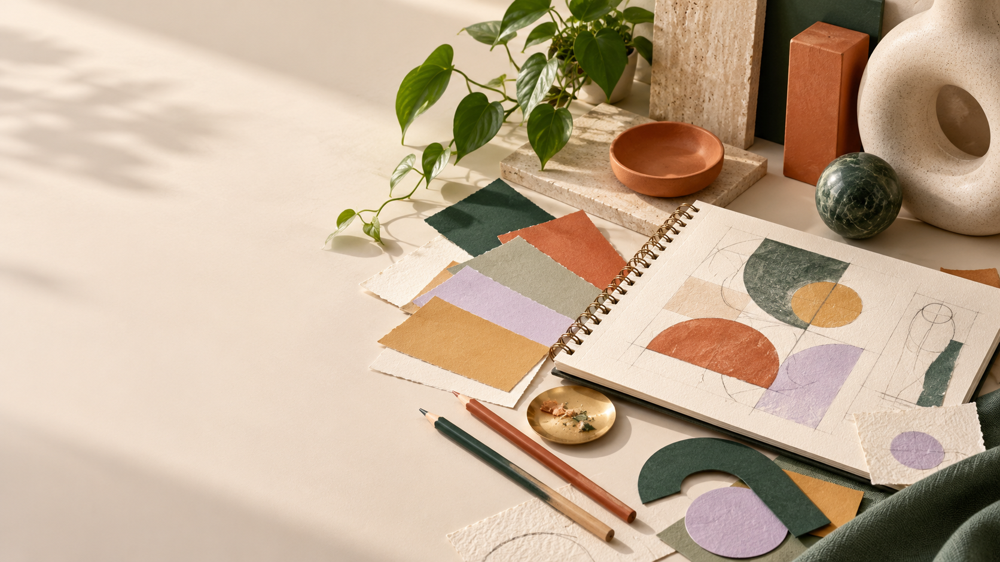
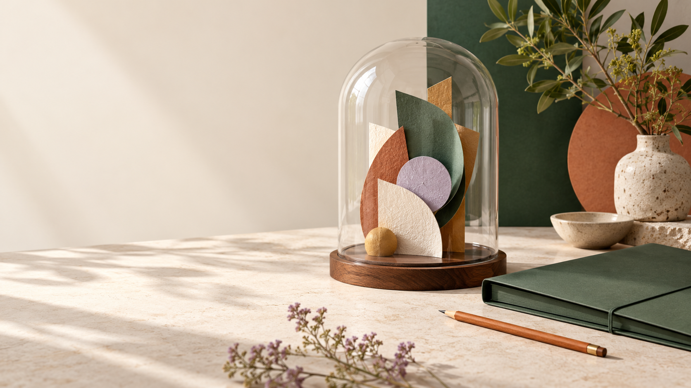
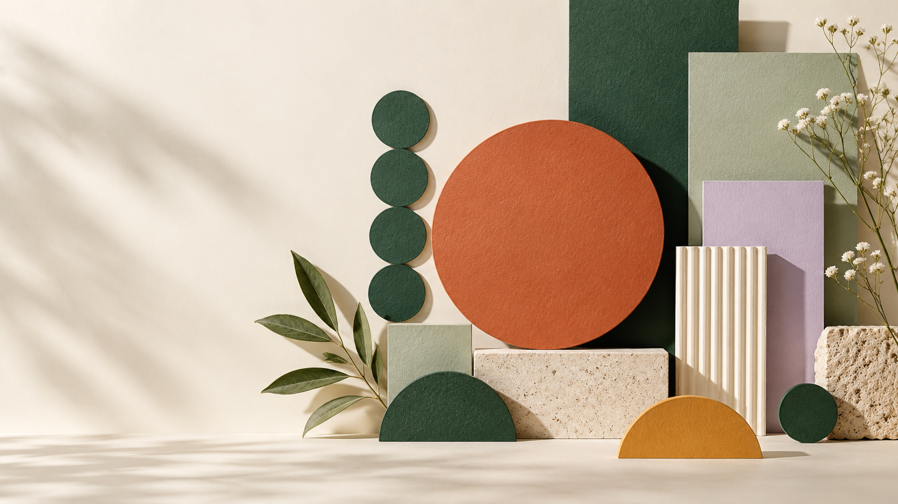
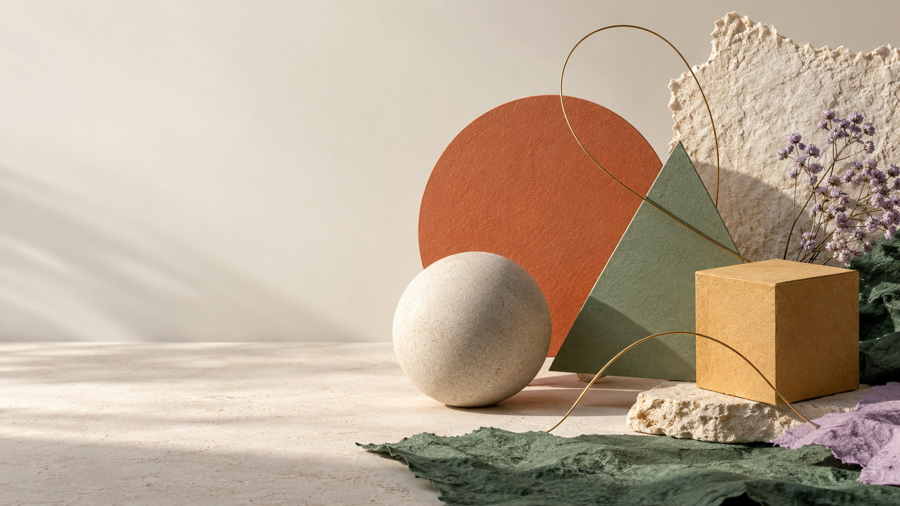
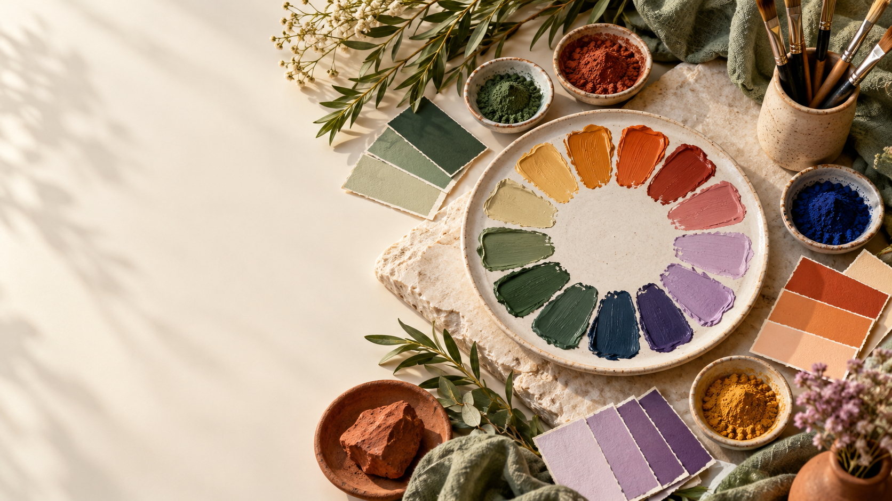
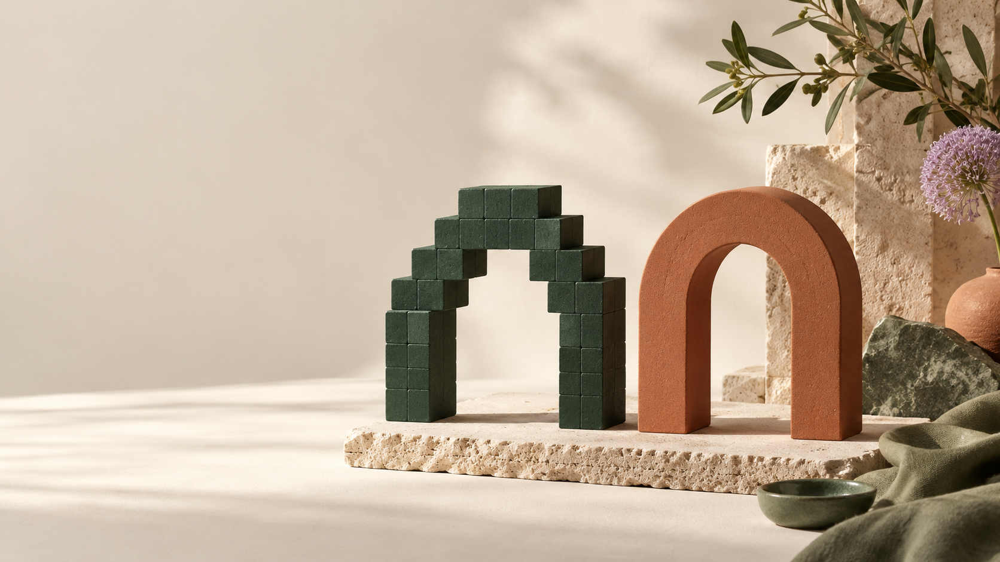
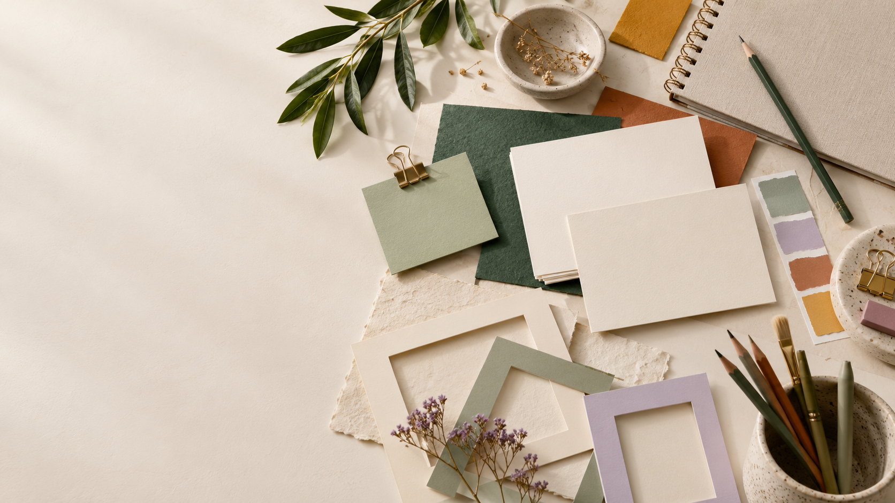
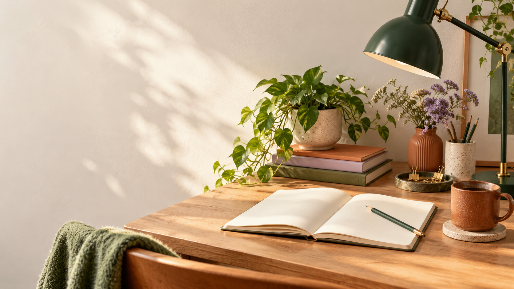
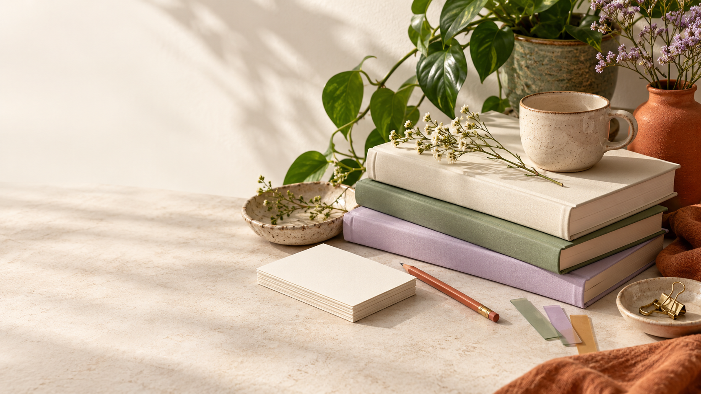

# Images for the Google Sites portfolio

Nine coordinated, AI-generated photographic-style banners. Each image is decorative; use the actual coursework files for the seven practical artifacts. Click a linked page name to open the full-size image, then use GitHub's download button or open the original image and save it.

## [Home](home.png)

Creative workspace with sketchbook, geometric studies and colour samples.

## [Copyright in Jamaica](copyright.png)

Paper sculpture protected by a glass dome, representing creative rights.

## [Design Principles](principles.png)

Balanced paper shapes, repeated circles and aligned cards.

## [Design Elements](elements.png)

Sphere, cube, flat shapes, wire and textured paper.

## [Colour Theory](colour.png)

Paint swatches, pigments and coordinated colour cards.

## [Raster & Vector](raster-vector.png)

Stepped block arch beside a smooth continuous arch.

## [Artefacts](artefacts.png)

Blank frames and drawing tools arranged for creative work.

## [Author](author.png)

Illustrative workspace with notebook, lamp and plant.

## [Bibliography](bibliography.png)

Plain books, index cards and bookmarks arranged for research.

