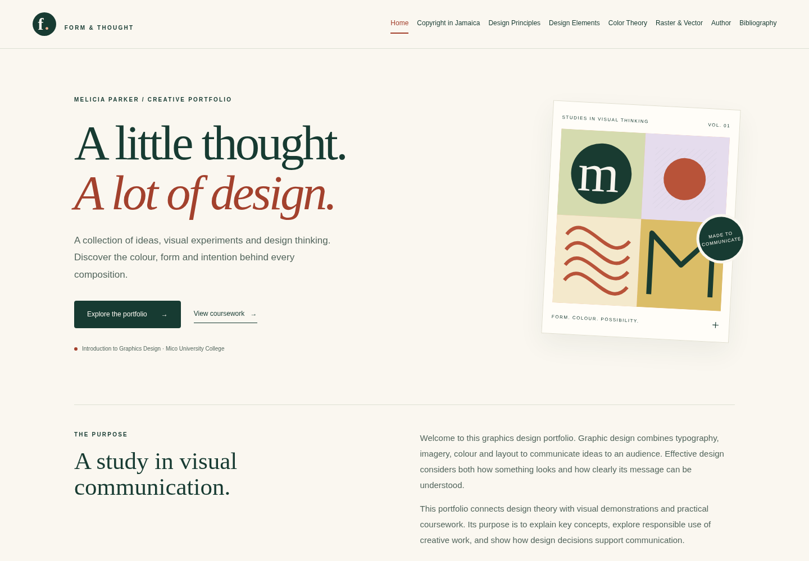

# Portfolio page previews

[Open the redesigned homepage cover](home-cover.png)

These screenshots show the website draft, not the Google Sites editor. Click any page name to open its full screenshot.

1. [Home](index.png)
2. [Copyright in Jamaica](copyright.png)
3. [Principles of Graphics Design](principles.png)
4. [Elements of Graphics Design](elements.png)
5. [Color Theory](color.png)
6. [Raster vs Vector Graphics](raster-vector.png)
7. [Author](author.png)
8. [Bibliography](bibliography.png)

The coursework artifacts, submission date and verified references are still pending.
